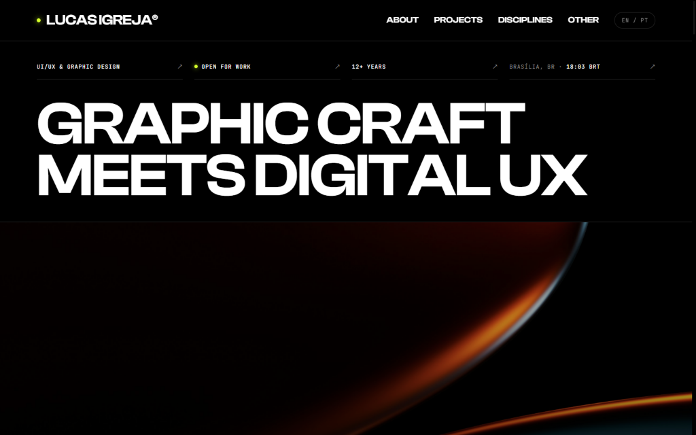
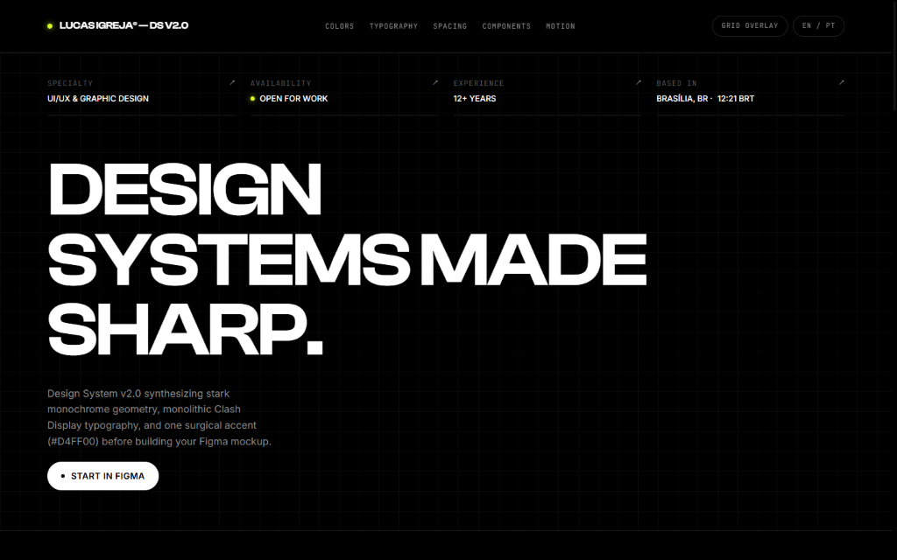
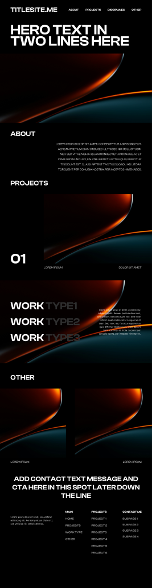

# Walkthrough — Lucas Igreja Portfolio (Phase 1, Phase 2 & Portable Handoff Complete)

The portfolio website is implemented in the `DesignPortfolio` workspace, translating your Figma mockup (`Desktop - 1`, `node-id=10:57`) and **Design System v2.0** into a responsive, bilingual (`EN / PT-BR`) experience showcasing all **9 Behance projects** and your 2013–2026 design trajectory.

### Visual Evidence

**Verified Desktop Hero (`1440×900`):**

**Design System v2.0 Specimen (`1440×900`):**

**Figma Mockup Reference (`Desktop - 1`, `10:57`):**

---

## Files Created

### Assets & Design System
- [`assets/hero-ambient.png`](../assets/hero-ambient.png) — Downloaded directly from Figma (`146,551` bytes); zero temporary Figma asset URLs remain in the codebase.
- [`assets/projects/README.md`](../assets/projects/README.md) — Guide for dropping high-res project cover exports into `assets/projects/`.
- [`css/tokens.css`](../css/tokens.css) & [`css/base.css`](../css/base.css) — v2.0 tokens (`--leading-hero: 0.86`, `overflow-x: clip` on `body` so sticky rails work cleanly).
- [`design.md`](../design.md) & [`design-system.html`](../design-system.html) — Live Design System v2.0 specification and interactive specimen.

### Portfolio Application
- [`index.html`](../index.html) — Semantic HTML5 document implementing the Figma layout:
  1. Sticky navigation (`LUCAS IGREJA®`, `ABOUT`, `PROJECTS`, `DISCIPLINES`, `OTHER`, `EN / PT` toggle, mobile drawer).
  2. Hero with 4-column hairline metadata strip (including live `America/Sao_Paulo` `BRT` clock), 2-line ALL-CAPS `Clash Display` headline, and full-bleed ambient artwork.
  3. Right-aligned `ABOUT` statement with outlined tool pills and `CAREER EVOLUTION` / `BEHANCE ARCHIVE` CTAs.
  4. `PROJECTS` section with discipline filters (`ALL (09)`, `UI/UX (02)`, `BRANDING (04)`, `EDITORIAL & OOH (03)`), left sticky `01`–`09` rail + `#D4FF00` progress bar, and right edge-bleed project stack.
  5. Full-bleed `DISCIPLINES` switcher (`UI/UX DESIGN`, `BRAND IDENTITY`, `ART DIRECTION`).
  6. Asymmetric `OTHER` edge-bleed dual cards (`CAREER EVOLUTION · 2013–2026` modal & `DESIGN SYSTEM V2.0` specimen link).
  7. Centered closing CTA (`COPY EMAIL · lucas.igreja@gmail.com`) and 4-column architectural footer.
- [`css/components.css`](../css/components.css) & [`css/modal.css`](../css/modal.css) — Sharp `0px` frame/modal geometry, bespoke CSS/SVG art-directed cover visuals, pill rolling-text hover transitions, and responsive tablet/mobile rules.
- [`js/data/projects.js`](../js/data/projects.js) — Bilingual `EN / PT-BR` copy, all **9 Behance projects** (*Sonar BSB*, *Olivia's Coffee Beans*, *GDF UnDF*, *GDF Secretaria de Economia*, *GDF Clube de Desconto*, *GDF Fábrica Social*, *Champion Volvo Novo XC60*, *Champion Volvo Brasília Design*, *CAU/BR Informes Publicitários*), 3 disciplines, and 6 career evolution milestones.
- [`js/components/portfolio.js`](../js/components/portfolio.js), [`js/motion/animations.js`](../js/motion/animations.js), & [`js/main.js`](../js/main.js) — UI rendering, filter state, Case-Study Modal (with Prev/Next & `Esc`), Career Evolution Modal, `EN / PT-BR` switching, GSAP + ScrollTrigger scroll zoom/reveals, sticky counter `IntersectionObserver`, and desktop custom cursor.

### Cross-Machine Portability & Handoff
- [`README.md`](../README.md) & [`HANDOFF.md`](../HANDOFF.md) — Project overview, preview commands, file manifest, technical invariants, and AI resume prompt.
- [`docs/CONVERSATION_HISTORY.md`](./CONVERSATION_HISTORY.md) & [`docs/history/conversation_log.json`](./history/conversation_log.json) — Chronological decision log and sanitized JSON transcript (`92` turns).
- [`scripts/serve.ps1`](../scripts/serve.ps1) & [`scripts/serve.sh`](../scripts/serve.sh) — Portable static preview servers for Windows and macOS/Linux.

---

## Browser Verification Summary

Verified live over HTTP (`localhost:4173`) after all website edits:
- **Layout & Overflow:** Zero horizontal overflow on Desktop (`1440×900`, `body` width `1432px`) and Mobile (`390×844`, `body` width `382px`, verified via bounding boxes and horizontal wheel check).
- **Console & Network Health:** Zero console errors, zero uncaught page errors, and `0` failed network requests (`assets/hero-ambient.png` returned HTTP `200` and rendered across all 4 slots).
- **Interactive Flows:**
  - Filter pills (`UI/UX (02)` → `BRANDING (04)` → `EDITORIAL & OOH (03)` → `ALL (09)`) updated visible card counts and sticky totals (`/ 02`, `/ 04`, `/ 03`, `/ 09`).
  - Scrolling projects dynamically updated `#stickyCounterNum` (`01` → `03` → `05`).
  - Case-Study Modal opened on `SONAR BSB`, advanced via `NEXT PROJECT` to `OLIVIA'S COFFEE BEANS`, and closed via `Escape`.
  - All 3 Disciplines switcher rows updated active state and `#disciplineCopy`.
  - Career Evolution Modal opened from the left `OTHER` card showing all 6 milestones (`2026` through `2010–2013`), while the right card links to `design-system.html`.
  - `EN / PT` toggle translated headings, nav, and dynamic cards to Portuguese and back to English; `COPY EMAIL` displayed toast confirmation.
